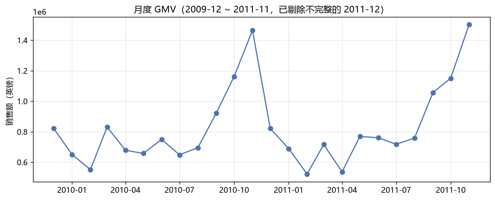
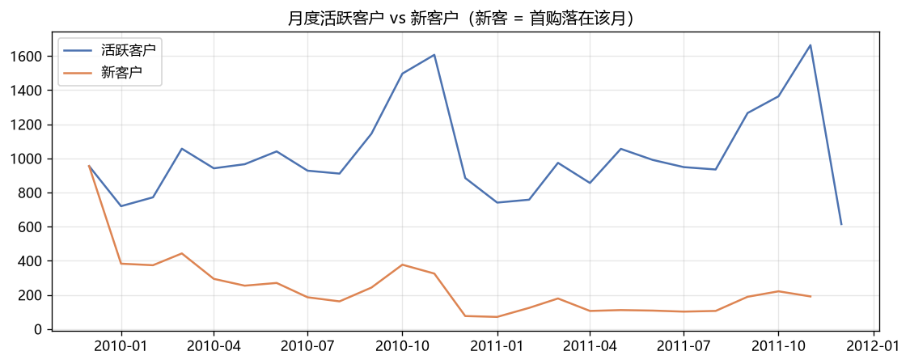
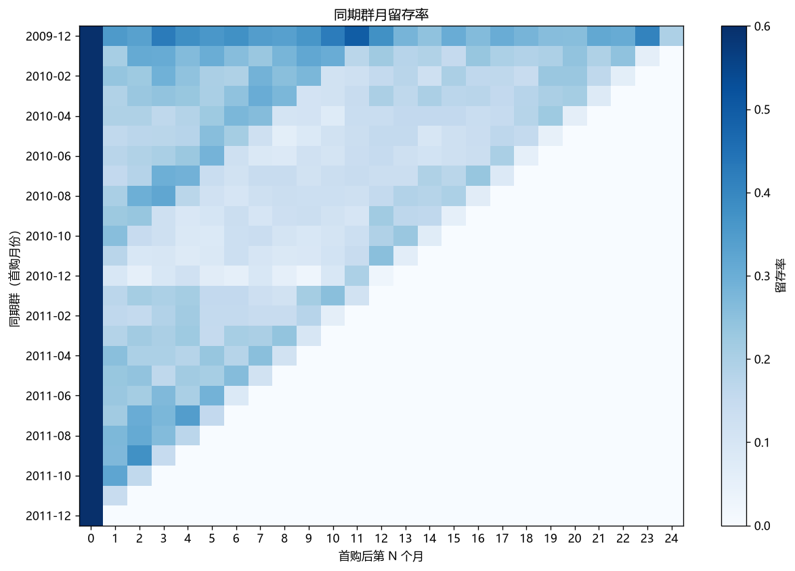
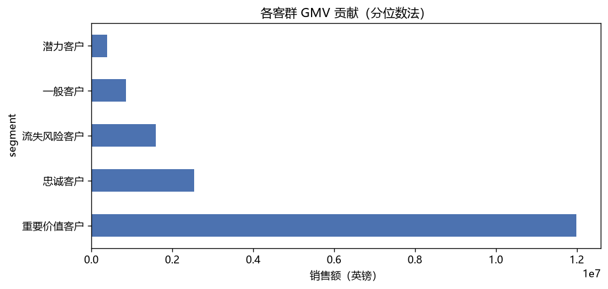
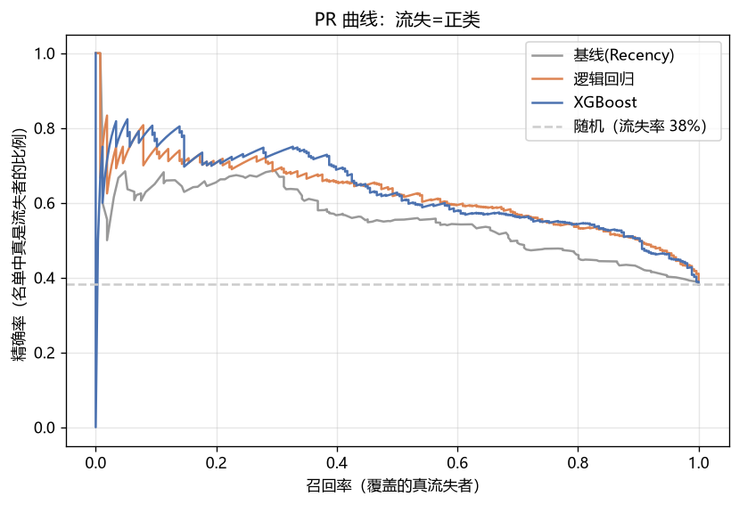
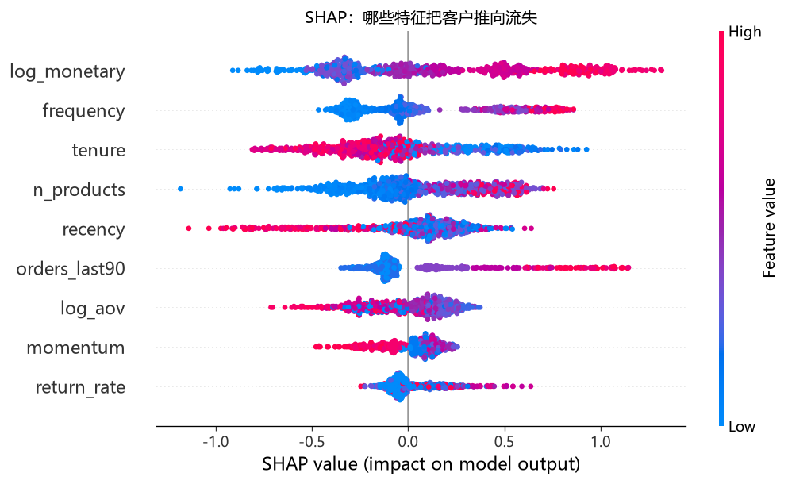

# 英国电商客户价值与流失分析报告

> **一句话结论**：增长引擎已经熄火（GMV 同比 +1.9%，新客 -55%），生意高度依赖 25% 的核心客户（贡献 69% GMV）；流失预警模型能在 90 天前识别高风险客户（AUC 0.758），配合 A/B 验证的挽留券投放预计 ROI 3.2x。

| | |
|---|---|
| 数据 | UCI Online Retail II：2009-12 ~ 2011-12，英国礼品电商，106 万条交易 |
| 分析周期 | 2026-11（4 周） |
| 工具 | Python（pandas / statsmodels / scikit-learn / XGBoost / SHAP）+ SQL |
| 决策问题 | 挽留券发给谁、发多少、如何验证效果 |

---

## 1. 业务背景

一家只做英国及欧洲市场的线上礼品电商。运营负责人手里有有限的挽留预算，需要回答三个问题：

1. 生意的健康度如何？（在增长还是在失血？）
2. 如果要花钱挽留客户，发给谁？
3. 怎么证明这钱花得值？

## 2. 数据与清洗

原始数据 1,067,371 行，清洗后保留 94.4%（交易表 1,007,913 行 + 退货表 19,494 行）。完整决策依据见 [docs/cleaning_rules.md](../docs/cleaning_rules.md)，关键处理：

| 问题 | 决策 | 依据 |
|---|---|---|
| 退货单（C 开头，19,494 行） | 拆分独立退货表 | 退货是业务信号，不是噪音 |
| Customer_ID 缺失（23.1% 行 / 14.8% 销售额） | 保留 + 标记，客户分析时剔除 | 缺失订单"又多又小"——直接删会低估 GMV 且有偏 |
| 2011-12 只有 9 天数据 | 月度趋势剔除该月 | 避免把数据截断当业绩暴跌 |
| 批发大单（单笔最大 £16.8 万） | 保留 | 长尾是真实客户价值，删掉 RFM 失真 |

## 3. 现状诊断：三个发现

### 发现 1：增长引擎熄火



- GMV 同比仅 **+1.9%**（2010 年 1-11 月 £901 万 → 2011 年同期 £918 万）
- 新客从 3,387 人跌至 1,508 人（**-55%**），而 2011-11 活跃客户中 **88.5% 是老客**



**解读**：增长全靠存量客户撑着。此时任何"拉新"故事都讲不圆，运营重心必须转向存量经营——挽留的优先级天然上升。

### 发现 2：价值高度集中，且新客承接在变差



- **25% 的重要价值客户贡献 69% GMV**（1,473 人，£1,199 万）；K-means 交叉验证更极端：8% 的客户贡献 55%
- 各同期群次月平均留存率仅 **21.2%**——每一届新客都接不住
- 客单价中位 £302 vs 均值 £511（P99 £4,409），典型长尾



**解读**：这是一个"少数大客户 + 大量一次性小客户"的脆弱结构。核心客户流失一个都很贵，而新客转化漏斗又在漏——两头都要管，但先管贵的这头。

### 发现 3：退货可控，但头部商品值得盯

整体退货率 4.4%（按件数），Top10 商品退货率 0-10% 不等（见 `reports/figures/05_top_products.png`）。

## 4. 流失预警模型

**设定**：对 2,788 位活跃客户（观察点前 180 天内有购买），用 **2011-09-10 之前**的行为特征预测**其后 90 天**是否复购（时点切割，杜绝数据泄漏）。90 天流失率 38.2%。

| 模型 | AUC | PR-AUC | 预算 10% 召回 | 预算 20% 召回 |
|---|---|---|---|---|
| 基线（按"多久没买"排序） | 0.682 | 0.556 | 16.5% | 33.5% |
| **逻辑回归**（7/9 特征显著） | **0.758** | 0.625 | 18.4% | 35.0% |
| **XGBoost** | 0.757 | 0.628 | 18.4% | **38.0%** |



**关键洞察**：

1. 逻辑回归几乎追平 XGBoost——行为特征与流失的关系近似单调线性，此时**可解释性比复杂度更值钱**
2. 谁真的在流失（OR，95% CI 均不跨 1）：累计消费 OR 3.67、品类宽度 1.50、近 90 天订单 1.58 → 越投入越留下；**客单价 OR 0.61、资历 OR 0.60 → 越高越危险**
3. 由此发现**假流失陷阱**：批发型大单客户天然低频，按"很久没买"去挽留他们纯属浪费预算（见建议 3）



## 5. 行动建议

### 建议 1（核心）：高风险客群挽留券，A/B 验证后放量

- **动作**：向流失评分 top20% 的 557 人发 £10 挽留券
- **测算**：成本 £5,570；假设增量回头率 +5pp（行业经验区间 3-8pp），留住一人值 90 天 £641（中位），预期增量收入 £17,852，**ROI ≈ 3.2x**
- **A/B 验证**：随机对半分组，主指标 90 天复购率。基线回头率 17%，MDE +8pp，α=0.05、power=0.8 → **每组需 412 人、共 824 人**；名单不足则扩至 top30%（836 人）
- **前提**：模型名单中排除建议 3 的批发型客户

### 建议 2：新客承接优化（次月留存 21.2% → 26.2%）

- **动作**：首购后 D+7 定向二单券 + 欢迎礼盒
- **测算**：1,508 新客 × +5pp = 多留住 75 人/年，按客单价中位 £303、人均年 1.5 单 → **年增量 GMV ≈ £34,274**
- **验证**：新客首购后随机分组，主指标 30 天二单率

### 建议 3：批发客户分流，别用券打扰他们

- **动作**：把 120 位高客单价客户（名单的 22%）从券名单摘出，转入大客户定期补货提醒 / 客户经理流程
- **收益**：直接省 £1,200 券成本；更重要的是避免对错误人群营销带来的品牌损耗和价格锚定下移
- **验证**：对比摘出组与未摘出组的后续 90 天复购与客单价变化

## 6. A/B 实验设计要点（建议 1 的落地细节）

| 要素 | 设计 |
|---|---|
| 分组 | 高风险名单随机 1:1，对照组不发券（**不能省**：17% 的人不发券也会自然回头） |
| 主指标 | 90 天复购率 |
| 样本量 | 每组 412 人（双侧 α=0.05，power=0.8，MDE +8pp，基线 17%） |
| 次指标 | 90 天累计消费、客单价（防券拉低客单价） |
| 决策规则 | p<0.05 **且** 计算后 ROI>1 才放量；方向反转立即止损 |
| 风险 | 新颖效应（前两周观察期剔除）、多轮发券的效应稀释 |

## 7. 局限与后续

- 数据止于 2011 年、单一公司、以英国为主（85% GMV），结论外推需谨慎
- 无营销触达/渠道/流量数据，"新客下滑"的根因（投放缩减？市场竞争？）不可识别
- 挽留券增量效应（+5pp）是假设而非本地实测——这正是 A/B 实验存在的意义
- 方向升级：uplift 建模（预测"券对谁最有效"而非"谁会流失"）、生存分析（预测流失时点）

## 附：复现方式

```bash
conda activate analyst
python src/get_data.py          # 下载数据 → parquet（约 45MB）
# 依次运行 notebooks/01~04（VS Code / Jupyter 选 analyst 内核）
```

---

*分析：suyifei309 · 2026-11 · [项目首页](../README.md)*
